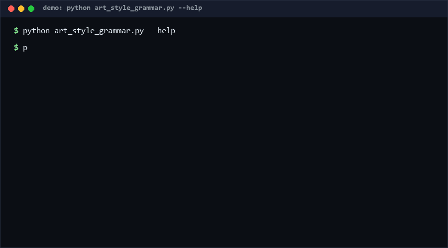

# art-style-grammar-matrix

A 35-style × 9-grammar card matrix that turns static artwork into animated explainers — plus a QA gate that refuses half-built cards. If you generate explainer animation from stills and need reproducible, testable output instead of one-shot model guesses, this is for you.

**Confidence: High (≥80%)** that the style×grammar factorization improves output reproducibility versus free-form prompting — the claim rests on determinism of the matrix itself (same inputs, same card), not on aesthetic quality, which stays subjective.

<p align="center"></p>

## Problem

Teams doing animated explainers face a quiet failure mode: every run reinvents the vocabulary. "Make it watercolor-ish, reveal the point slowly" is not a spec; it is a wish. Downstream QA then has nothing to check against — a card may be missing motion hints, have a wrong step count, or silently drift schema. The industry answer is bigger end-to-end video models, which trade *controllability* for *fluency*.

The overlooked angle: animation direction is a **2-D orthogonal enumerable space** — visual style and narration grammar vary independently. 35 styles × 9 grammars = 315 well-formed cards, each fully checkable by a machine. You do not need a model to guarantee structure; you need a dictionary, a cross-product, and a gate.

## How it works

Three stages, borrowed from content-pipeline practice:

1. **Style dictionary** (35 entries): `watercolor`, `ink-wash`, `cel-shaded`, `stop-motion-clay`, `neon-noir`, … Each style carries a palette hint and a motion hint (e.g. stop-motion-clay → `12fps stepped poses`).
2. **Grammar dictionary** (9 entries): `reveal`, `compare`, `build-up`, `timeline`, `zoom-drill`, `cause-chain`, `metaphor-map`, … Each grammar is a fixed step template (e.g. `zoom-drill = macro-shot → zoom-in → micro-detail → zoom-out`).
3. **Delivery gate** (`qa_check`): validates required fields, dictionary membership, step-count conformance, and schema version. A card either passes or gets an exact failure list.

## Quickstart

Minimal example (~10 s):

```bash
python art_style_grammar.py compose --style watercolor --grammar zoom-drill
```

Full matrix (~15 s, writes 315 cards):

```bash
python art_style_grammar.py enumerate --out cards.json   # ~2 s
python art_style_grammar.py qa --file cards.json          # note: qa takes one card; matrix output is a wrapper — see Limits
python self_test.py                                       # ~5 s, all tests
```

## Why not X

| Alternative | Why not | What we keep instead |
|---|---|---|
| End-to-end text-to-video model | Non-deterministic; structure (step counts, schemas) cannot be unit-tested; cost per iteration is high | Deterministic cards; spend model budget only inside steps |
| Free-form prompt templates | Vocabulary drifts per author; no gate possible; audit = reading prose | Closed dictionaries + machine-checkable schema |
| Full animation framework (Lottie/Rive pipeline) | Heavy runtime dependency; prescribes rendering, not direction | Framework-agnostic JSON cards you can feed anywhere |

## Minimal Fallback

No Python? Read `grammars` output and apply it by hand:

```text
zoom-drill = macro-shot → zoom-in → micro-detail → zoom-out
compare = show-A → show-B → isolate-difference → verdict
```

Even without running code, the 9 step templates are a usable checklist for editing any explainer. (The QA gate is what you lose — review step counts manually.)

## Design Trade-offs

Priority order when requirements conflict: **determinism > auditability > aesthetic quality > coverage**. Consequences:

- Closed dictionaries, not open tags: adding a style is a code change with a self-test, not a config edit. Slower to extend, impossible to corrupt silently.
- The gate rejects, it does not auto-repair. Humans fix cards; the tool only guarantees rejection is precise.

## Limits & Second-order Effects

- 315 cards is a *coverage floor*, not proof of quality; the gate checks structure, not taste.
- Second-order effect: if this gate is adopted as the only QA, teams may stop watching outputs and ship structurally-valid-but-bland animation ("green-tint drift"). Keep at least one human review pass.
- A frozen dictionary can ossify taste; version the schema (v1.1) so old cards stay auditable after dictionary growth.
- The `qa` subcommand takes a single card object, not the enumerate wrapper file — piping enumerate output into qa will FAIL on schema. This is intentional (wrapper ≠ card) but easy to trip on.

## FAQ

**Q: Does this generate video?**
A: No. It generates *directed, validated card specs* — the boring 20% of the pipeline that, when missing, causes 80% of rework.

**Q: Can I add my own styles?**
A: Yes — append to `STYLES` plus a palette rule, then run `self_test.py`. Dictionary edits ship with tests.

**Q: When you should NOT use this tool?**
A: If your goal is one bespoke artistic piece with a human director making every frame call — the matrix will feel like bureaucracy. It pays off at volume, multi-author teams, or when cards must pass automated pipelines.

**Q: Why is the gate so strict about step counts?**
A: Because a 3-step `reveal` is not a shorter reveal — it is a broken one. Strictness is the product.

## [Core Assumptions]

1. Explainer animation direction factors into independent style and grammar axes; interactions exist but are secondary (hence motion hints, not motion rules).
2. A machine-checkable structure requirement is more valuable than expressive freedom for team-scale output.
3. Consumers of these cards are downstream agents/renderers that accept JSON, not humans reading prose.
4. Aesthetic quality remains a model/human concern; this asset claims only controllability and reproducibility.

---

Data and style/grammar counts: as of 2026-10-11. License: MIT (zhengming contributors).
